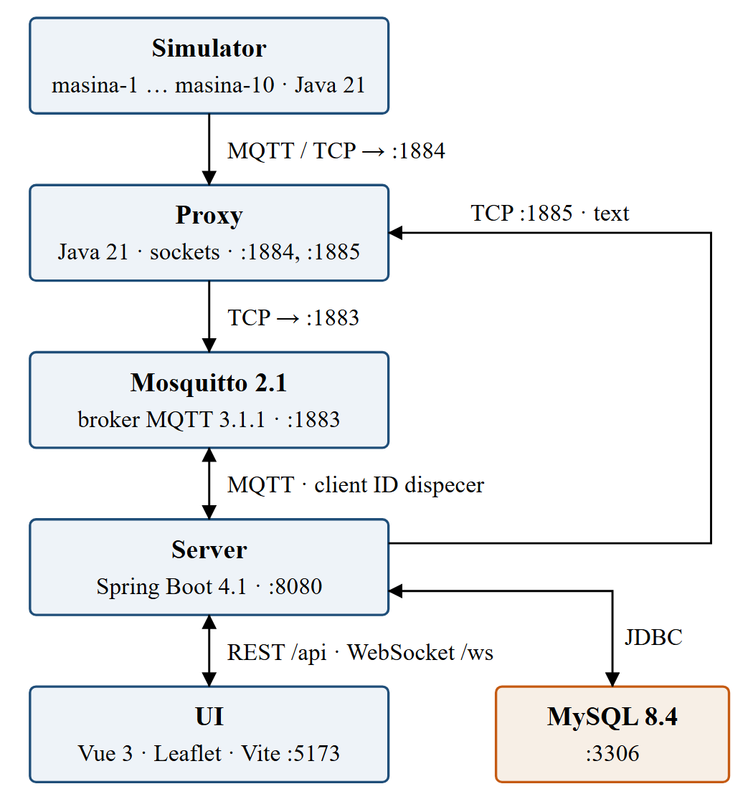
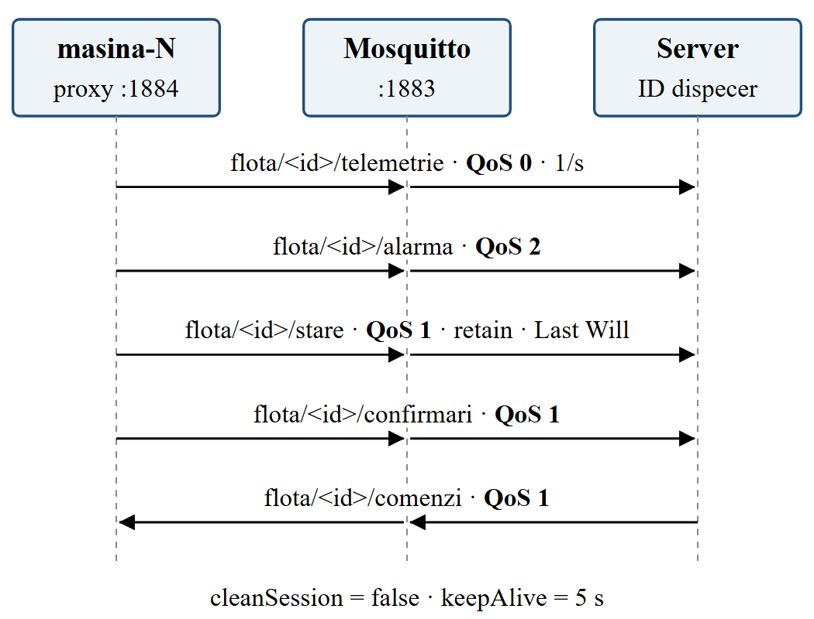
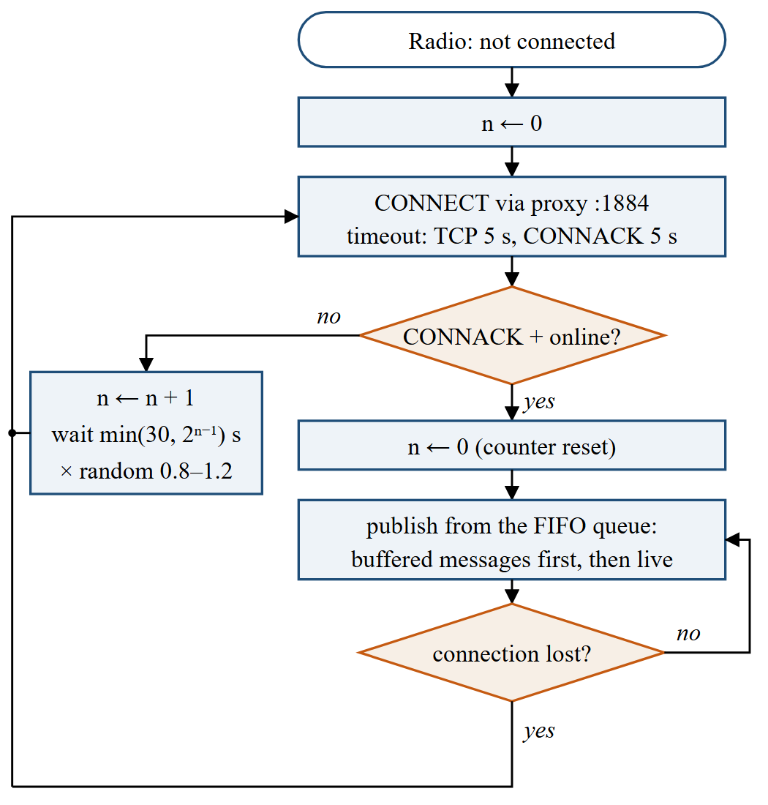
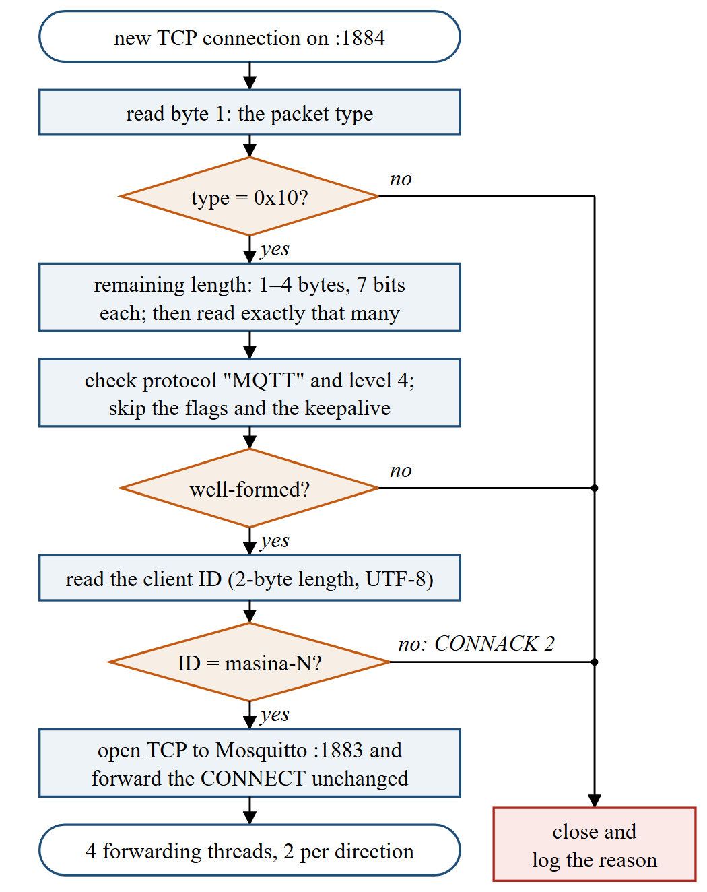
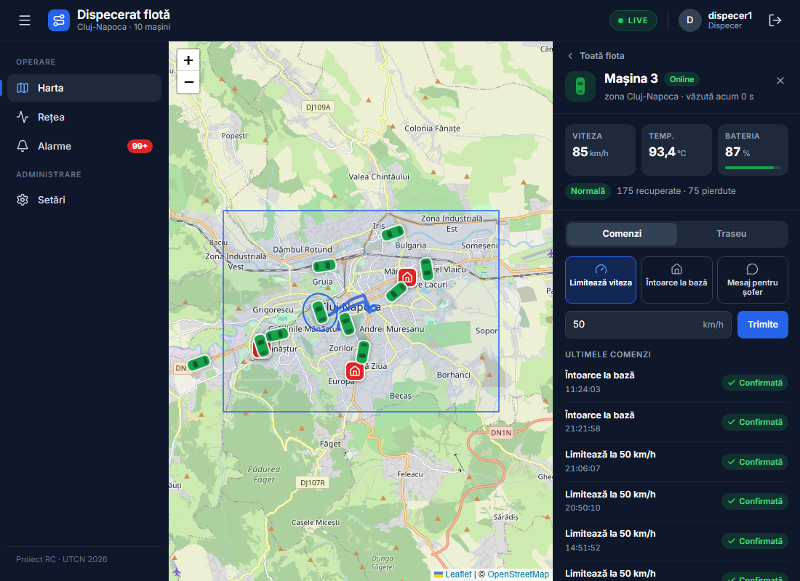
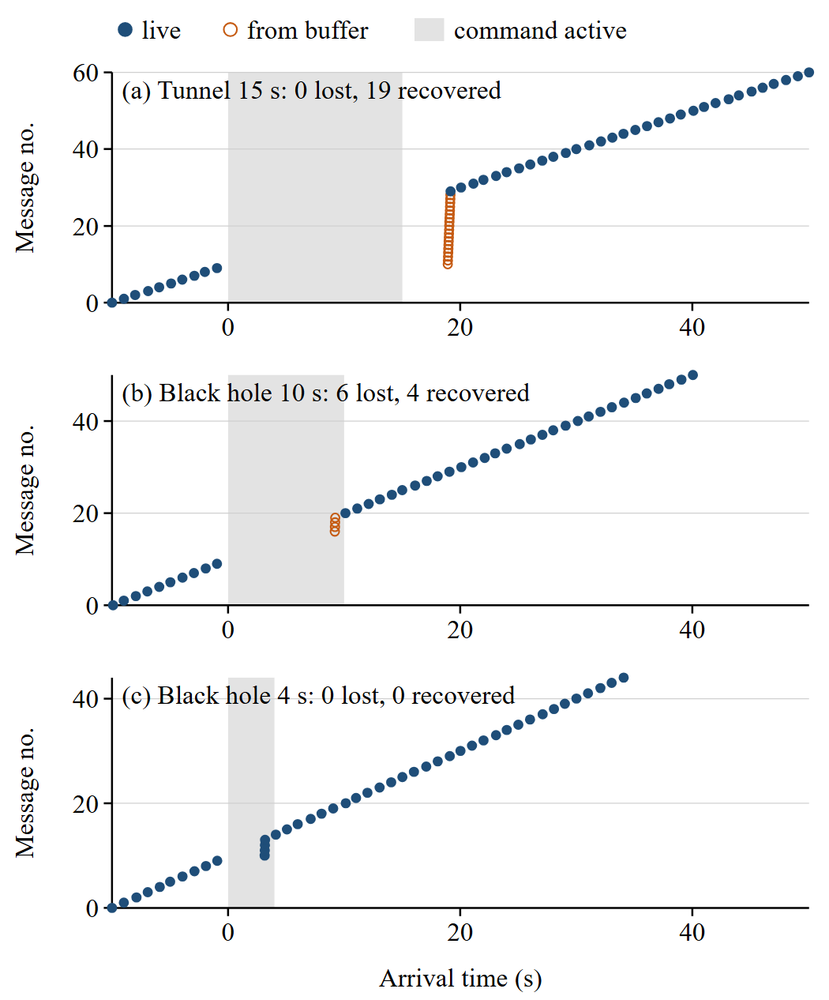
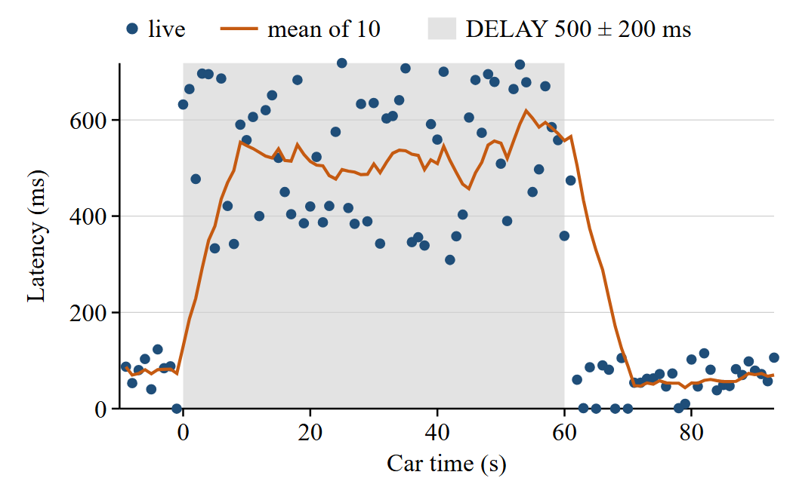

# Introduction

A delivery van that enters a road tunnel keeps driving, measuring and producing data, but its modem cannot reach the network. A dispatcher watching a live map expects the van to reappear on the other side with its route intact. Whether that happens depends on several layers working together: the transport protocol, the messaging protocol, the device firmware and the server.

MQTT [1] is the usual choice for this kind of telemetry. It runs over TCP [2], it uses a broker to decouple publishers from subscribers, and it offers three quality-of-service (QoS) levels: at most once, at least once and exactly once. These guarantees, however, hold only between a client and the broker while a session exists. They do not say what a device should do with messages produced while it is offline, nor how quickly it notices that it is offline.

This paper describes a complete system built to observe these effects in a controlled way: ten simulated cars, a network proxy that injects faults on command, an MQTT broker, a server that stores and checks every message, and a web dispatcher. The contributions are:

- a fault-injecting TCP proxy that understands just enough of MQTT to identify each car, and that distinguishes a *tunnel* (the connection is cut) from a *black hole* (the connection stays open but nothing passes);
- a car model that buffers messages while disconnected and replays them in order, with exponential backoff and jitter on reconnection;
- a measurement of message loss, recovery and latency under four network conditions, with the queries kept next to the data so that the numbers can be reproduced.

The project is software only. The course allows a project without hardware if it behaves as an IoT application with several servers and clients, so the hardware assembly that a physical deployment would need does not apply here.

# Related Work

Surveys of IoT messaging protocols compare request-reply protocols such as HTTP and CoAP with publish-subscribe protocols such as MQTT, AMQP and DDS, along latency, energy and throughput [3]. A measurement through a common middleware found that MQTT delivers with lower delay than CoAP at low packet loss and with higher delay at high loss, because of TCP retransmissions [4]. Our experiments complement such studies by looking at outages of several seconds rather than at random packet loss.

Mosquitto is a widely used open-source MQTT broker and client library [5]; we use it unchanged. Network conditions are commonly emulated below the application, either in the kernel, as Dummynet does with finite queues, bandwidth limits and delays [6], or with the Linux NetEm queueing discipline [7]. These tools act on packets and do not know which application connection a packet belongs to. Our proxy works one level higher: it reads the first MQTT packet of every TCP connection, so a fault can target a single car by its client identifier, and it runs on Windows without administrator rights, next to the rest of the system.

# System Architecture

The system has five components, shown in Fig. 1. The simulator runs ten cars, each an independent MQTT client. The cars connect to the proxy on port 1884, and the proxy forwards their bytes to Mosquitto on port 1883. The server connects to Mosquitto directly, with the client identifier `dispecer`, so it never passes through the degraded network. It stores the history in MySQL and serves the web interface over HTTP on port 8080, with a REST API for queries and a WebSocket [8] channel for live updates. The proxy accepts plain-text orders on port 1885; the server translates the dispatcher's weather requests into these orders. All components run on one laptop and listen only on the loopback interface.

Fig. 2 shows the MQTT topics. Every car publishes telemetry once per second on QoS 0, since a lost reading is soon replaced by the next one. Alarms use QoS 2: they are rare and must arrive exactly once. The state topic uses QoS 1 with the retain flag, and the broker publishes `offline` on it as the car's Last Will when a connection dies without a clean disconnect. Commands from the dispatcher travel on QoS 1, and the car answers with a confirmation on QoS 1. Both cars and server use persistent sessions (`cleanSession = false`), so the broker keeps queued commands while a car is away. The keepalive interval is 5 s.

# Implementation

## The car: engine, radio and buffer

Each car is two threads joined by a FIFO queue, the classic producer-consumer pattern. The *engine* runs once per second: it moves the car along its route through Cluj-Napoca, computes speed, temperature and battery, and puts a telemetry message in the queue, marked `din_buffer` if the radio is disconnected at that moment. The *radio* owns the MQTT connection. While connected, it takes messages from the queue and publishes them in order; otherwise it tries to reconnect.

The queue is the buffer. It holds at most 300 messages, five minutes of telemetry; when it is full, the oldest telemetry is dropped, but alarms and confirmations never are. Every telemetry message carries a sequence number `seq` and the car's own timestamp.

The radio does not rely on the client library's automatic reconnection. Fig. 3 shows its logic. A connection attempt waits at most 5 s for TCP and 5 s for the broker's CONNACK, and counts as successful only after the car has also published its retained `online` state. After the n-th failed attempt, the radio waits min(30, 2^(n−1)) s multiplied by a random factor between 0.8 and 1.2, so that ten cars leaving a tunnel together, or a broker restart, do not produce a synchronized burst of reconnections. After a success, the counter is reset, and because the queue is FIFO, the buffered messages reach the server before the live ones.

## The proxy: CONNECT, weather and orders

For every car, the proxy keeps two TCP connections: one with the car and one with the broker. To know which car a connection belongs to, it reads the first MQTT packet completely before forwarding anything, as shown in Fig. 4. The packet must be a CONNECT (type 0x10). Its *remaining length* is decoded from one to four bytes, seven bits per byte, with the high bit announcing a further byte. The proxy then checks the protocol name `MQTT` and level 4, skips the connect flags and the keepalive, and reads the client identifier. Only identifiers of the form `masina-N` are accepted; any other client receives a CONNACK with return code 2, "identifier rejected", and is closed. The original CONNECT, including the Last Will, is then forwarded unchanged. This is the only place in the project that looks inside an MQTT packet.

Each direction of a connection has a reading thread and a writing thread, joined by a queue of byte chunks, each tagged with the earliest time at which it may leave. A single thread that read and then slept during the delay would add the delays of successive chunks; with separate writers, every chunk is delayed independently. The departure time of a chunk is never earlier than that of the previous chunk, so the byte order guaranteed by TCP is preserved even with random jitter.

The "weather" of each car is one of the following. A *delay* of `ms ± v` milliseconds holds every chunk. A *bandwidth* limit makes the writer sleep for the time the chunk would take at the given rate. A *tunnel* closes both connections at once; while it lasts, new connections from the car are accepted but never answered, exactly as a modem that has lost the network would experience a TCP connection that never completes. A *black hole* keeps both connections open, but the writers stop writing; if the connection survives the hole, the held bytes are released. Delay and bandwidth can be combined, while tunnel and hole are temporary and override them.

Orders arrive on port 1885 in a line-based ASCII protocol, for example `TUNEL masina-3 15` or `INTARZIERE TOATE 500 200`. Every line receives `OK` or `ERR` with a reason, and `STARE` returns one line per car followed by a line containing a single dot, as in SMTP.

## The server: rules, idempotence and live updates

For each telemetry message, the server stores the position with its arrival time and compares `seq` with the last number seen. A jump forward adds the gap to the car's lost counter, while a message marked `din_buffer` adds to its recovered counter. Because simulator and server share one clock, the latency of a live message is simply its arrival time minus the car's timestamp; on separate machines the clocks would have to be synchronized, for example with NTP.

Three alarm rules run on the server and fire on transitions only: leaving the car's zone, tested with the ray-casting point-in-polygon algorithm; exceeding the zone's speed limit; and staying offline longer than a configurable threshold, 60 s by default. The rules also run on replayed positions, so a car that left its zone inside a tunnel still raises the alarm, stamped with the car's time. Alarms from the cars arrive on QoS 2 and are stored without duplicate checks. Confirmations arrive on QoS 1 and may therefore arrive twice; a command moves from `TRIMISA` to `CONFIRMATA` or `RESPINSA` only once, which makes the handling idempotent.

Live updates reach the browser through a plain WebSocket handler: positions, states, alarms, confirmations, network events and, once per second, the per-car statistics. Fig. 5 shows the dispatcher's map with one car selected and its recent route.

## Authentication

The dispatcher has two roles: `DISPECER`, who watches the fleet and sends commands, and `ADMIN`, who also manages accounts and settings. Passwords are stored as bcrypt hashes [9]. A successful login returns a token of 32 random bytes from `SecureRandom`, encoded in unpadded Base64URL as 43 characters, stored in MySQL and valid for eight hours from login. The browser sends it in the `Authorization: Bearer` header; a single interceptor on `/api/**` answers 401 without a valid token and 403 when the role is insufficient. Browsers cannot set headers on a WebSocket handshake, so the live channel receives the token as a query parameter and is refused without a valid one. Logging out deletes the token and the server closes every WebSocket opened with it, using the application close code 4001.

# Experimental Evaluation

## Method

All measurements were run on the developer's laptop with Mosquitto 2.1.2 and the full system running. A PowerShell script drives each run: it resets the car's counters, waits 20 s, sends the order to the proxy, waits for the order to end and for the car to come back online, and then waits 30 s more. Once per second it reads the car's state from the database, which gives the time spent offline. Afterwards, an SQL query kept in the repository exports the car's positions in the window. The tunnel and both holes were repeated three times; the delay was run once, for 60 s.

## Results

Table I summarizes the four experiments. Fig. 6 shows one run of each outage, with the arrival time of every message relative to the order.

Table: Message loss, recovery and latency (mean of three runs; range in parentheses)

| Run | Lost | Recovered | Offline (s) | Latency (ms) |
|---|---|---|---|---|
| E1 tunnel 15 s | 0 | 19 (18–20) | 17.7 (17–18) | – |
| E2 hole 10 s | 6.3 (6–7) | 3.7 (3–4) | 3 | – |
| E3 hole 4 s | 0 | 0 | 0 | 1983, p95 ≤ 4124 |
| E4 delay 500 ± 200 ms | 0 | 0 | 0 | 532, p95 700 |

The latency column covers only live messages sent while the order was active. During the tunnel no live message was sent, and during the 10 s hole only one, in one of the three runs, so these two rows have no latency.

**Tunnel (E1).** The proxy closes the connection, so the car knows at once that it is offline and stores every message. No message was lost; 18 to 20 messages were replayed from the buffer, in order, as the vertical column of hollow points in Fig. 6(a) shows. The car stayed offline for about 18 s, longer than the 15 s tunnel, because during the tunnel every connection attempt waits the full 5 s for a CONNACK and is followed by a growing pause, so the first successful attempt comes a few seconds after the tunnel ends.

**Black hole of 10 s (E2).** Here the connection looks alive. The car keeps publishing on QoS 0, and the messages stay in the proxy, until the keepalive mechanism detects the silence after about 6.6 s and the connection is closed. The bytes held by the proxy are discarded with it. Those 6 to 7 messages are lost for good; the remaining 3 to 4, produced after detection, come from the buffer (Fig. 6(b)).

**Black hole of 4 s (E3).** A hole shorter than the keepalive detection time loses nothing. The messages wait in the proxy and arrive together when the hole ends, with delays of up to 4.1 s (Fig. 6(c)).

**Delay (E4).** A delay of 500 ± 200 ms applied to the whole fleet for 60 s raised the mean latency of live messages to 532 ms, with a 95th percentile of 700 ms. No car went offline, no message was buffered, and the order of the messages did not change, because the proxy never lets a chunk leave before the previous one. Fig. 7 shows the latency of each message together with a moving average over ten messages.

All four results match the behaviour predicted in the design.

# Discussion and Limitations

The experiments show that what matters for QoS 0 telemetry is not how long an outage lasts but whether the device can see it. A visible outage, such as the tunnel, costs only delay, because the car switches to its buffer at once. A silent outage costs exactly the messages published between its start and its detection, so the keepalive interval directly sets the worst-case loss: a shorter keepalive loses less but adds traffic and more false disconnections on a slow link. Publishing telemetry on QoS 1 would avoid the loss at the price of acknowledgements for every message.

The system has clear limits.

- **Unencrypted HTTP.** Passwords, tokens and messages travel in clear text; anyone who can capture traffic on the network can read the password at login and reuse the token until it expires. TLS 1.3 [10] would protect the REST API, the WebSocket and the MQTT connections; it was left out of scope to keep the protocol behaviour visible in the experiments.
- **Token in the WebSocket address.** Because the token is part of the URL, it may appear in server or proxy logs; a short-lived ticket exchanged over the authenticated REST API would avoid this.
- **A single laptop.** All components share one machine and one clock. This makes latency easy to measure, but it hides clock skew and the interference of a real radio network.
- **Simulated cars.** The cars follow pre-computed routes and produce synthetic readings. The proxy reproduces the effect of an outage on a TCP connection, not the radio itself.

# Conclusion

We built a dispatch system for a simulated vehicle fleet and a fault-injecting proxy that can take one car or the whole fleet into a tunnel, a black hole or a slow network. With an on-board buffer and reconnection with exponential backoff, a 15 s tunnel lost no data, while a 10 s black hole lost about six messages because the outage stayed invisible until the keepalive expired. A hole shorter than that expiry and a fixed delay only delayed the messages. The setup turns MQTT's QoS levels and keepalive from definitions into effects that can be shown on a live map and measured, and it can be extended with TLS or with QoS 1 telemetry to measure their cost in the same way.

# References

[1] A. Banks and R. Gupta, Eds., "MQTT Version 3.1.1," OASIS Standard, Oct. 2014. [Online]. Available: http://docs.oasis-open.org/mqtt/mqtt/v3.1.1/os/mqtt-v3.1.1-os.html
[2] W. Eddy, Ed., "Transmission Control Protocol (TCP)," RFC 9293, IETF, Aug. 2022, doi: 10.17487/RFC9293.
[3] J. Dizdarević, F. Carpio, A. Jukan, and X. Masip-Bruin, "A survey of communication protocols for Internet of Things and related challenges of fog and cloud computing integration," ACM Computing Surveys, vol. 51, no. 6, pp. 1–29, 2019, doi: 10.1145/3292674.
[4] D. Thangavel, X. Ma, A. Valera, H.-X. Tan, and C. K.-Y. Tan, "Performance evaluation of MQTT and CoAP via a common middleware," in Proc. IEEE 9th Int. Conf. Intelligent Sensors, Sensor Networks and Information Processing (ISSNIP), Singapore, 2014, pp. 1–6, doi: 10.1109/ISSNIP.2014.6827678.
[5] R. A. Light, "Mosquitto: server and client implementation of the MQTT protocol," Journal of Open Source Software, vol. 2, no. 13, p. 265, 2017, doi: 10.21105/joss.00265.
[6] L. Rizzo, "Dummynet: a simple approach to the evaluation of network protocols," ACM SIGCOMM Computer Communication Review, vol. 27, no. 1, pp. 31–41, 1997, doi: 10.1145/251007.251012.
[7] S. Hemminger, "Network emulation with NetEm," in Proc. Linux Conf. Australia (linux.conf.au), Apr. 2005.
[8] I. Fette and A. Melnikov, "The WebSocket Protocol," RFC 6455, IETF, Dec. 2011, doi: 10.17487/RFC6455.
[9] N. Provos and D. Mazières, "A future-adaptable password scheme," in Proc. FREENIX Track: 1999 USENIX Annual Technical Conference, Monterey, CA, USA, 1999, pp. 81–92.
[10] E. Rescorla, "The Transport Layer Security (TLS) Protocol Version 1.3," RFC 9846, IETF, 2026.
