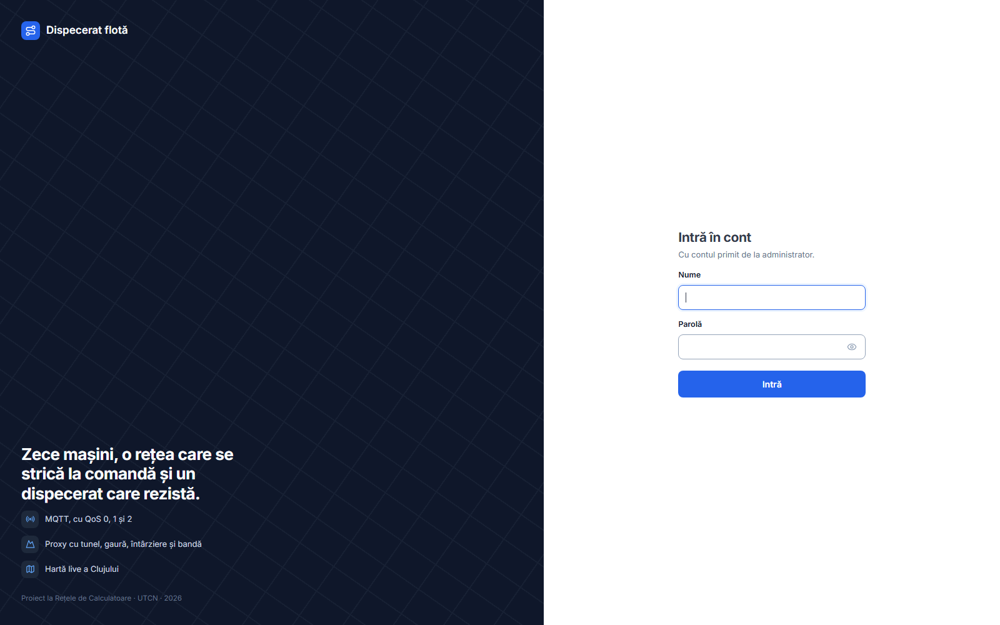
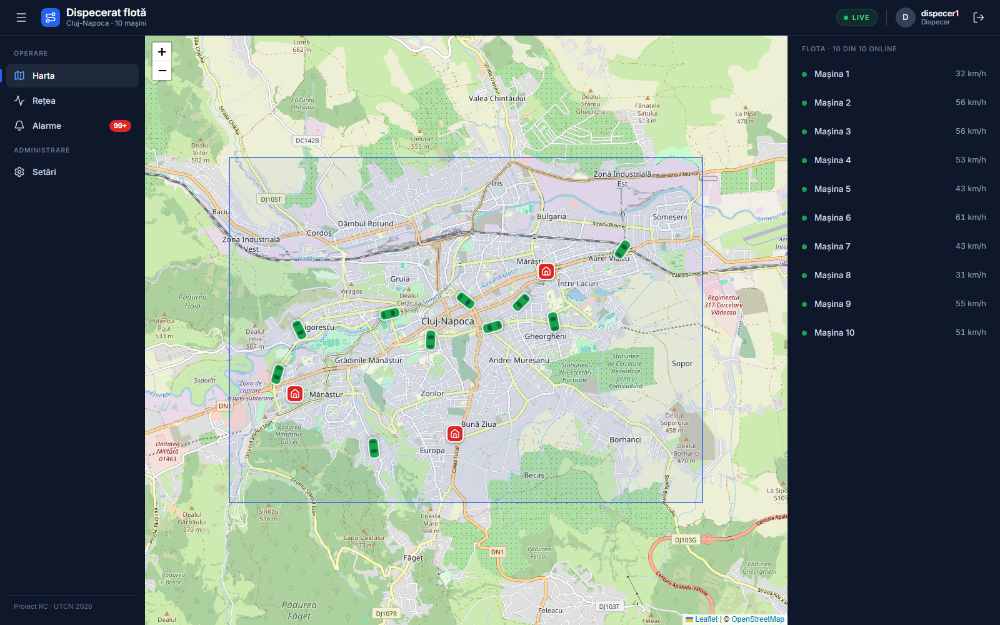
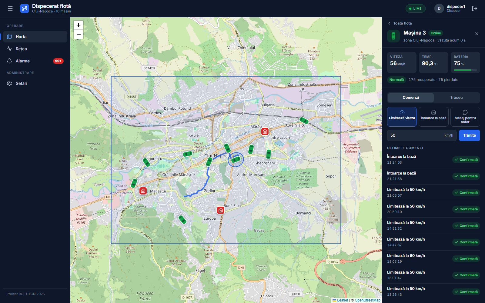
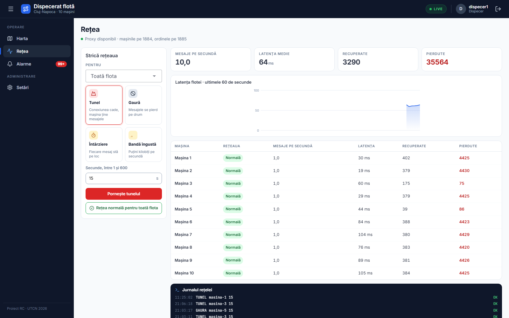
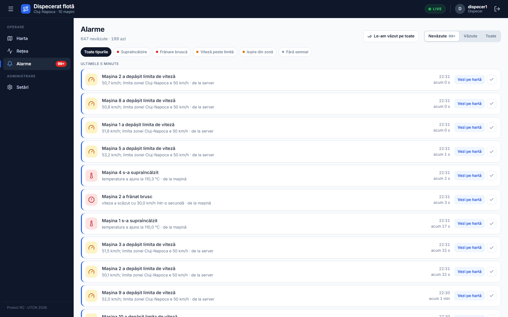
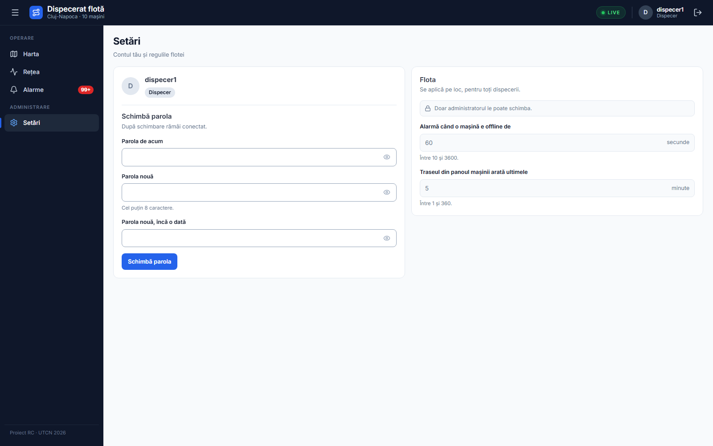
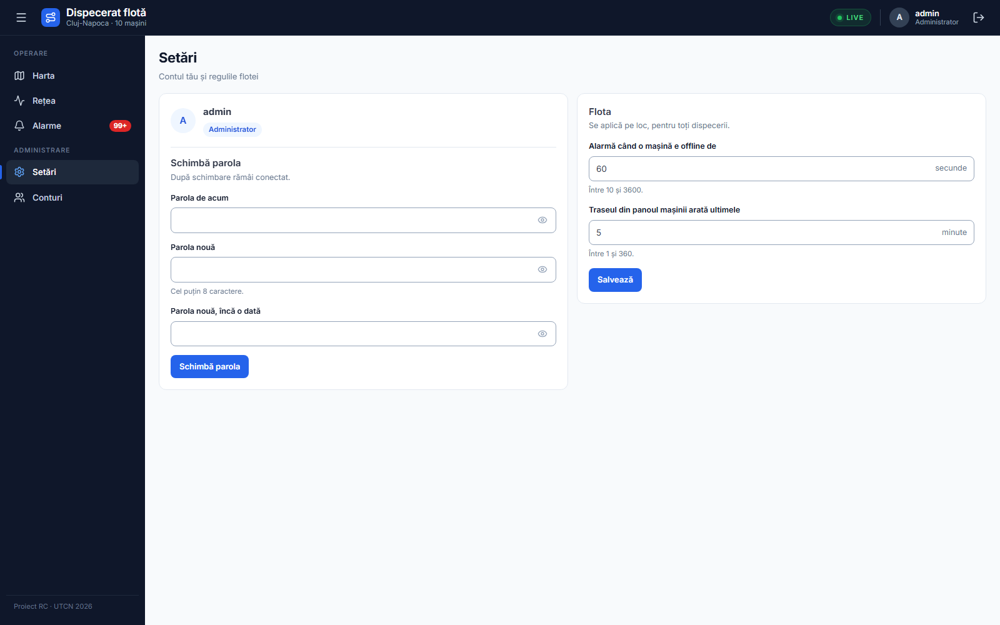
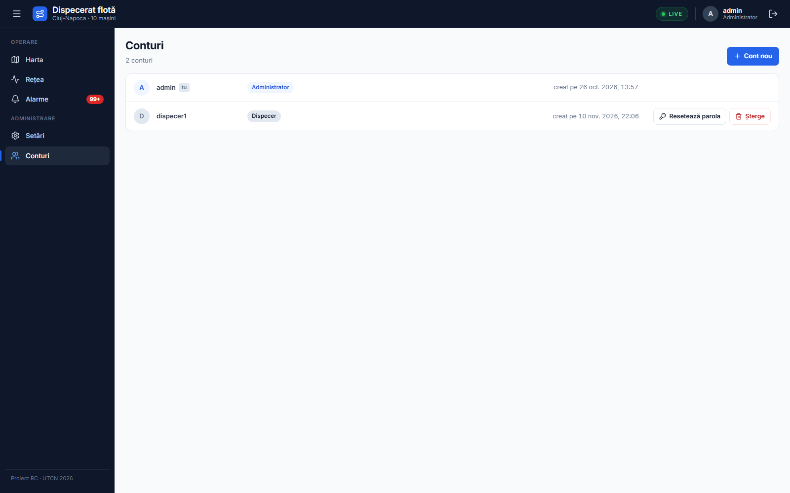

# 1. Ce este aplicația

Dispeceratul urmărește pe hartă o flotă de zece mașini care trimit date o dată pe secundă: poziția, viteza, temperatura motorului și bateria. Mașinile sunt simulate pe calculator și circulă pe străzile Clujului, fiecare pe tura ei, din una dintre cele trei baze: Mănăștur, Mărăști și Bună Ziua.

Între mașini și restul sistemului stă un proxy de rețea, care poate strica legătura la comandă: o întârzie, o îngustează, o taie ca într-un tunel sau o lasă deschisă, dar mută, ca o gaură neagră. Dispecerul vede pe hartă cum rezistă sistemul și poate trimite comenzi mașinilor.

Aplicația are cinci piese, toate pe același calculator:

- **A, broker-ul MQTT,** Mosquitto, pe portul 1883, prin care trec toate mesajele;
- **P, proxy-ul,** pe porturile 1884, pentru mașini, și 1885, pentru ordinele de rețea;
- **S, serverul,** pe portul 8080, care salvează istoricul în MySQL și dă alarmele;
- **W, interfața,** pe portul 5173, deschisă în browser;
- **C, simulatorul,** cu cele zece mașini.

Interfața are două roluri. **Dispecerul** lucrează cu harta, pagina Rețea, alarmele și comenzile. **Administratorul** poate, în plus, să facă și să șteargă conturi și să schimbe setările flotei.

# 2. Ce trebuie instalat

## Programele

- **Java 21,** de exemplu Eclipse Temurin, de pe adoptium.net. Maven nu trebuie instalat: proiectul îl aduce singur, prin `mvnw.cmd`.
- **Node.js 24,** de pe nodejs.org, pentru interfață.
- **MySQL 8.4,** de pe dev.mysql.com, instalat ca serviciu Windows, cu numele `MySQL84`.
- **Mosquitto 2.1.2,** de pe mosquitto.org, în `C:\Program Files\mosquitto`. Serviciul Windows al lui Mosquitto poate rămâne oprit: broker-ul se pornește din proiect, cu configurarea lui.
- **Git,** ca să aduci proiectul:

```powershell
git clone https://github.com/tudorraducristian/Dispecerat-Flota-RC.git
```

Comenzile din acest manual se dau în PowerShell, din folderul proiectului.

## Baza de date

O singură dată, cu serviciul MySQL pornit, faci baza `flota` și utilizatorul ei. Comanda îți cere parola de root a MySQL:

```powershell
Get-Content mysql\creeaza-baza.sql | & "C:\Program Files\MySQL\MySQL Server 8.4\bin\mysql.exe" -h 127.0.0.1 -u root -p
```

Tabelele le face serverul singur, la prima pornire.

## Bibliotecile interfeței

Tot o singură dată, și după fiecare actualizare care schimbă `web\package.json`:

```powershell
cd web; npm install
```

# 3. Pornirea pieselor, în ordine

Fiecare piesă rulează într-o fereastră PowerShell separată, deschisă în folderul proiectului. Ordinea contează: broker-ul înaintea proxy-ului și a serverului, iar simulatorul la sfârșit. Înainte de toate, serviciul MySQL trebuie să fie pornit, din `services.msc`.

**A, broker-ul:**

```powershell
& "C:\Program Files\mosquitto\mosquitto.exe" -c mosquitto\mosquitto.conf -v
```

**P, proxy-ul:**

```powershell
.\mvnw.cmd -q -pl proxy compile exec:java
```

**S, serverul.** E gata când în fereastră apare „Conectat la Mosquitto”:

```powershell
.\mvnw.cmd -q -pl server spring-boot:run
```

**W, interfața.** După pornire, deschizi http://127.0.0.1:5173 în browser:

```powershell
cd web; npm run dev
```

**C, simulatorul,** care leagă cele zece mașini la proxy:

```powershell
.\mvnw.cmd -q -pl simulator compile exec:java
```

Opțional, **O, ordinele pentru proxy,** date de mână, de exemplu `TUNEL masina-3 15` sau `STARE`:

```powershell
powershell -NoProfile -ExecutionPolicy Bypass -File unelte\ordine.ps1
```

Fiecare piesă se oprește cu Ctrl+C. La întrebarea „Terminate batch job (Y/N)?” răspunzi Y.

## De pe telefon

Interfața se poate deschide și de pe telefon, dacă telefonul și calculatorul sunt în aceeași rețea, de exemplu pe hotspot-ul telefonului. În locul pasului W pornești `npm run telefon`, apoi deschizi pe telefon adresa de pe rândul `Network` afișat de Vite, de exemplu `http://192.168.137.1:5173`. Dacă Windows întreabă, lași Node.js în rețelele private.

# 4. Login-ul și contul de admin

La prima pornire, serverul face contul `admin` și îi scrie parola o singură dată în fereastra lui, ca avertisment:

```
Am creat contul admin. Parola, afișată o singură dată: …. Schimb-o din Setări.
```

În browser, pe http://127.0.0.1:5173, intri cu numele `admin` și parola din fereastră, apoi o schimbi din Setări (capitolul 8). Pagina de login e în Fig. 1.



- Conturile noi le face doar administratorul, din pagina Conturi. Din pagina de login nu se poate face un cont.
- O sesiune ține 8 ore de la login. După aceea, aplicația te duce din nou la login.
- Butonul de ieșire, din dreapta sus, te scoate din aplicație pe toate filele browserului deschise cu același login.

# 5. Harta

Harta e pagina principală (Fig. 2). În stânga stă meniul, cu numărul alarmelor nevăzute; butonul ☰ îl ascunde. În dreapta stă lista flotei, cu viteza fiecărei mașini.



- **Culoarea mașinii:** verde, online; gri, offline; portocaliu, cu o „vreme” de rețea pusă pe ea.
- **Zona** flotei e dreptunghiul albastru, iar bazele sunt marcate cu o casă roșie.
- **Alertele** apar sus, pentru fiecare alarmă nouă, pe orice pagină. „Vezi pe hartă” deschide mașina.
- **Chip-ul LIVE** din bara de sus arată că interfața primește date. Dacă scrie „FĂRĂ LEGĂTURĂ”, serverul nu răspunde.

Un clic pe o mașină, pe hartă sau în listă, deschide panoul ei (Fig. 3). Panoul arată viteza, temperatura, bateria, câte mesaje au venit din buffer și câte s-au pierdut. Are două file.



- **Comenzi:** „Limitează viteza”, cu o viteză între 10 și 130 km/h, „Întoarce la bază” și „Mesaj pentru șofer”. Sub ele, ultimele comenzi, cu starea lor: „Așteaptă mașina” până răspunde mașina, apoi „Confirmată” sau „Respinsă”. O comandă dată cât mașina e offline ajunge când ea revine.
- **Traseu:** drumul mașinii din ultimele minute. Linia plină înseamnă date venite pe loc, linia punctată date venite mai târziu, din buffer, iar o porțiune lipsă înseamnă date pierdute.

# 6. Rețea

Pagina Rețea (Fig. 4) strică legătura dintre mașini și broker, ca să se vadă cum rezistă sistemul.



În cardul „Strică rețeaua” alegi mașina sau toată flota, apoi felul:

- **Tunel:** conexiunea cade; mașina ține mesajele și le trimite când iese.
- **Gaură:** conexiunea rămâne deschisă, dar nu mai trece nimic; mesajele de pe drum se pot pierde.
- **Întârziere:** fiecare mesaj stă pe loc câteva sute de milisecunde, cu o variație.
- **Bandă îngustă:** puțini kilobiți pe secundă.

Tunelul și gaura țin câte secunde alegi, între 1 și 600. Butonul „Rețea normală pentru toată flota” le oprește pe toate. Dedesubt, pagina arată starea proxy-ului, mesajele pe secundă, latența, mesajele recuperate și pe cele pierdute, pentru toată flota și pentru fiecare mașină, graficul latenței pe ultimul minut și jurnalul rețelei, cu fiecare ordin trimis și răspunsul lui.

# 7. Alarme

Pagina Alarme (Fig. 5) arată alarmele ca un flux de carduri, cele mai noi sus.



Tipurile de alarmă:

- **Supraîncălzire** și **Frânare bruscă:** le trimite mașina;
- **Viteză peste limită**, **Ieșire din zonă** și **Fără semnal:** le dă serverul. „Fără semnal” vine când o mașină e offline mai mult decât pragul din Setări.

Sus, filtrele Nevăzute, Văzute și Toate, plus filtrul după tip. Bifa de pe un card marchează alarma ca văzută, iar „Le-am văzut pe toate” le marchează pe toate. „Vezi pe hartă” deschide mașina pe hartă.

# 8. Setări și Conturi

## Setări

Pagina Setări are două carduri. Cu „Contul meu” își schimbă oricine parola: parola de acum, apoi parola nouă de două ori, de cel puțin 8 caractere. După schimbare rămâi conectat.

Cardul „Flota” are două setări, valabile pentru toți dispecerii:

- **Alarmă când o mașină e offline de,** între 10 și 3600 de secunde, implicit 60;
- **Traseul din panoul mașinii arată ultimele,** între 1 și 360 de minute, implicit 5.

Dispecerul le vede, dar nu le poate schimba (Fig. 6). Administratorul le schimbă și apasă „Salvează” (Fig. 7).





## Conturi

Pagina Conturi (Fig. 8) apare în meniu doar pentru administrator.



- **Cont nou:** numele, de 3–20 caractere, din litere mici, cifre, punct, `_` sau `-`; parola, de cel puțin 8 caractere; rolul, Dispecer sau Administrator. Rolul nu se mai schimbă după creare.
- **Resetează parola:** îi dai contului o parolă nouă; omul e scos din aplicație și intră cu parola nouă.
- **Șterge:** cere o confirmare. Propriul cont și ultimul administrator nu se pot șterge, iar propria parolă se schimbă din Setări.

# 9. Probleme frecvente

## „Access denied” la MySQL

**Simptom:** serverul se oprește la pornire, cu `Access denied for user 'flota'`.

**Cauza:** baza și utilizatorul `flota` nu au fost făcute, au fost făcute cu altă parolă sau serviciul MySQL nu rulează.

**Ce faci:**

- verifici în `services.msc` că serviciul `MySQL84` rulează;
- rulezi din nou `mysql\creeaza-baza.sql` ca root, după capitolul 2; scriptul se poate rula de mai multe ori;
- verifici că te poți conecta cu utilizatorul aplicației:

```powershell
& "C:\Program Files\MySQL\MySQL Server 8.4\bin\mysql.exe" -h 127.0.0.1 -u flota -pflota flota -e "SELECT 1"
```

## Un port ocupat

**Simptom:** o piesă se oprește la pornire: serverul cu „Port 8080 was already in use”, Vite cu „Port 5173 is already in use”, proxy-ul sau Mosquitto cu o eroare despre adresa deja folosită.

**Cauza:** piesa rulează deja, într-o fereastră uitată deschisă, sau alt program folosește portul. Porturile aplicației sunt 1883, 1884, 1885, 3306, 8080 și 5173.

**Ce faci:** afli cine ține portul, de exemplu 8080, apoi închizi fereastra sau programul acela:

```powershell
Get-NetTCPConnection -LocalPort 8080 -State Listen | ForEach-Object { Get-Process -Id $_.OwningProcess }
```

Pentru broker, dacă serviciul Windows Mosquitto rulează, îl oprești din `services.msc` și îl lași pe „Manual”.

## OneDrive blochează build-ul

**Simptom:** `mvnw.cmd` sau `npm install` se oprește cu o eroare de acces la un fișier din `target\` sau `node_modules\`.

**Cauza:** proiectul stă într-un folder sincronizat cu OneDrive, iar OneDrive ține fișierul deschis cât îl urcă.

**Ce faci:** pui sincronizarea OneDrive pe pauză, din iconița lui din bara de jos, cât rulezi comanda, apoi o repornești.

## Broker-ul e oprit

**Simptom:** toate mașinile devin gri, iar în fereastra serverului apare „Deconectat de la Mosquitto”.

**Cauza:** fereastra A s-a închis sau Mosquitto nu pornește.

**Ce faci:** pornești din nou A, după capitolul 3. Serverul se reconectează singur în cel mult 10 secunde, iar mașinile în cel mult 30. Dacă Mosquitto nu pornește deloc, folosești HiveMQ CE, mai jos.

## Dacă Mosquitto nu pornește: HiveMQ CE

Aplicația merge cu orice broker MQTT 3.1.1 de pe 127.0.0.1:1883, fără nicio schimbare de cod. Rezerva e HiveMQ CE, un broker gratuit scris în Java.

O dată, din timp: descarci `hivemq-ce-2026.5.zip` de pe pagina de release-uri a proiectului `hivemq-community-edition` de pe GitHub, îl dezarhivezi în `C:\hivemq-ce-2026.5`, în afara OneDrive, și copiezi configurarea proiectului peste cea din arhivă:

```powershell
Copy-Item hivemq\config.xml C:\hivemq-ce-2026.5\conf\config.xml -Force
```

Când e nevoie, în locul pasului A:

```powershell
$env:HIVEMQ_JMX_ENABLED = 'false'; & C:\hivemq-ce-2026.5\bin\run.bat
```

Variabila `HIVEMQ_JMX_ENABLED` e obligatorie: fără ea, HiveMQ deschide spre toată rețeaua un port de administrare fără parolă.

## Alte situații

- **Harta e goală, fără străzi:** calculatorul n-are internet; fundalul hărții vine de la OpenStreetMap. Mașinile și traseele se văd și fără el.
- **„Proxy indisponibil” pe pagina Rețea:** P nu rulează. Îl pornești, iar mașinile revin în cel mult 30 de secunde.
- **Parola contului admin s-a pierdut:** în baza `flota` rulezi `DELETE FROM utilizatori WHERE nume = 'admin';`, apoi repornești S. Serverul face din nou contul, cu o parolă nouă scrisă în fereastra lui.
