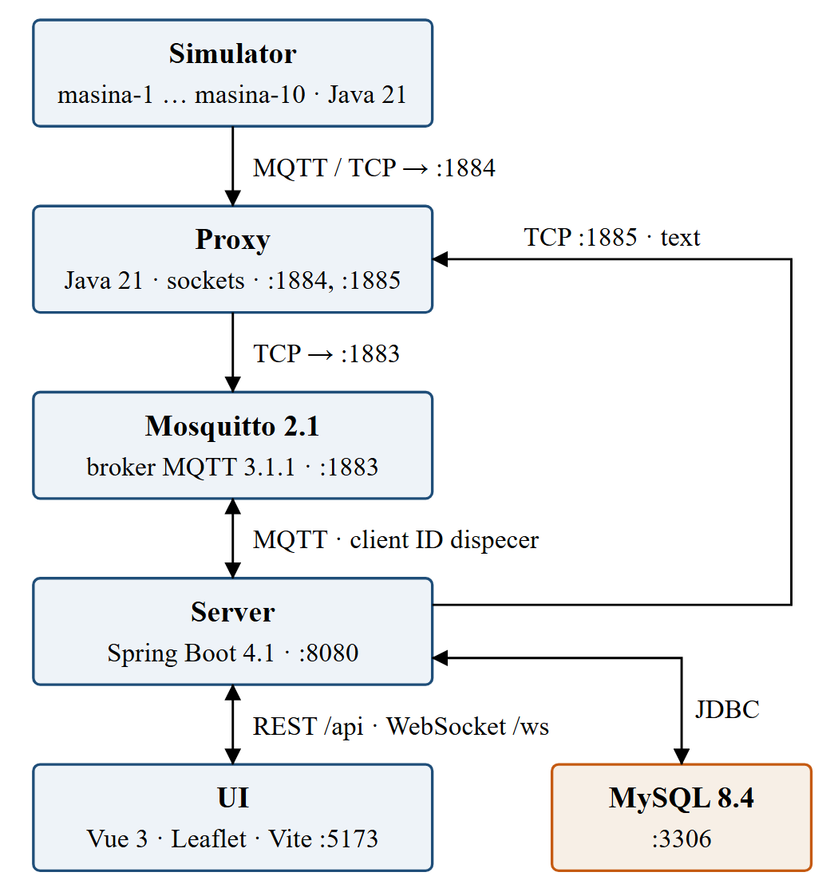

# Introduction

A body paragraph with **bold text**, *italic text* and `code text`.

## A second level

- the first bullet
- the second bullet with **bold**

### A third level

Another body paragraph.

Table: An example table head

| Experiment | Lost |
|---|---|
| Tunnel | 0 |
| Hole | 6 |

# References

[1] A. Author, "A first reference," 2020.
[2] B. Author, "A second reference," 2021.
